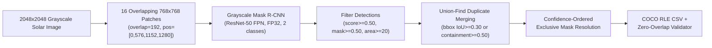

# Solar Filament Instance Segmentation (MAGFiLO 1.0 / Kaggle 2026)

If you look at a full-disk H-alpha image of the Sun, solar filaments show up as dark, winding ribbons of cool plasma suspended above the chromosphere. In the **Solar Filament Segmentation Challenge 2026** (`filament-segmentation-2026`), the job is to find every individual filament in a `2048 × 2048` grayscale solar image and output a separate, non-overlapping COCO RLE mask for each one.

Sounds straightforward enough, right? Grab a pretrained Mask R-CNN, split the dataset, train for a dozen epochs, run inference, and submit.

Well, almost every single step of that naive plan ran into a surprise once we actually inspected the data. This repository is the clean, reproducible version of our investigation — keeping the exact engineering decisions, measured results, and the warts we didn't fix yet.

---

## What we found when we actually looked at the data

Before writing a single line of training code, we audited the competition dataset (`MAGFiLO_1.0_Kaggle_2026`: 707 training images, 180 test images, all `2048 × 2048` single-channel grayscale JPEGs from GONG H-alpha observations). Three findings shaped the entire pipeline:

### 1. 1,154 COCO records, but only 707 physical images

When we first loaded `MAGFiLO_1.0_Annotations_kaggle2026_train.json`, COCO reported **1,154 images** and **8,199 annotations**. Wait — why were there only 707 `.jpeg` files in `train/train_images/`?

Because **296 physical images were annotated multiple times** by different annotator passes (distinct COCO ID prefixes like `050101-...`, `050102-...`, `050103-...` pointing to the exact same JPEG):
- `411` images have 1 annotation record
- `145` images have 2 annotation records
- `151` images have 3 annotation records

Even worse: the annotators disagree heavily. On `20131007075314Th.jpeg`, the three annotators' foreground union masks only had pairwise IoUs of **`0.4778`**, **`0.4009`**, and **`0.3604`**.

Our very first `train_test_split` split on COCO record IDs — which would have leaked the exact same solar images into both training and validation. Catching this early let us switch to a **physical-filename split** (85/15, `random_state=42`): **600 unique training images** (992 records) and **107 unique validation images** (162 records), with zero filename overlap.

### 2. Filaments are tiny, thin, and mostly empty bounding boxes

Across all 8,199 polygon annotations (`Left`: 30.92%, `Right`: 31.59%, `Unidentifiable`: 37.49%, `Ambiguous`: 0% — collapsed to a single foreground class for this competition):
- **Median mask area**: `1,228 px` (just **0.029%** of a `2048 × 2048` image)
- **Median bounding box**: `74.5 × 69.6 px` (max width `1,067 px`, max aspect ratio `12.78`)
- **Median bounding-box occupancy** (`mask_area / bbox_area`): **`24.3%`**

Three quarters of the pixels inside a typical filament's bounding box are background solar disk. Resizing a `2048 × 2048` image down to `512 × 512` would turn small filaments into mush, so we had to keep native resolution via overlapping patches.

### 3. Ground-truth masks are practically non-overlapping

Auditing all 8,199 masks turned up `0` empty masks, `0` invalid masks, and only `5` records out of 1,154 with any intra-record overlap (just **1** pair in the whole dataset with IoU ≥ 0.50: an apparent duplicate `Right` annotation in `010403-20160810234034Lh` with IoU `0.7242`). That matches the competition's strict non-overlapping mask requirement.

For the full EDA breakdown, see [docs/dataset_analysis.md](docs/dataset_analysis.md).

---

## How the pipeline works



### Patching — and the experiment we threw away

We compared three patch sizes with 25% overlap (`512`, `768`, `1024`):
- `512 × 512` (25 patches/image): `90.84%` of instances fully contained in at least one patch.
- **`768 × 768`** (overlap `192`, stride `576`, positions `[0, 576, 1152, 1280]`, 16 patches/image): **`96.89%`** fully contained (`7,944 / 8,199`).
- `1024 × 1024` (9 patches/image): `98.73%` fully contained.

We picked `768 × 768`. Our first dataset prototype tried to be clever by dropping any patch that sliced across a filament boundary. When we audited that rule, it discarded `44.58%` of all patches and left **`50.36%` of filament instances without clean coverage** (and 4 images with zero valid patches). So we threw that idea out: the final `SolarFilamentDataset` keeps all 16 patches, clips intersecting masks to the patch boundary, recomputes tight bounding boxes, and picks **one annotation record per physical image per epoch** (`set_epoch`) during training so the model isn't given contradictory labels for the same image inside an epoch.

### Model & the FP16 stability surprise

We started from Torchvision's COCO-pretrained `maskrcnn_resnet50_fpn` (`43.9M` total parameters, `43.7M` trainable):
- Replaced `backbone.body.conv1` with a 1-channel `Conv2d` initialized to the mean of the 3 RGB channels.
- Replaced the box and mask heads for 2 classes (`background`, `filament`).
- Set grayscale normalization to `image_mean = [0.326]`, `image_std = [0.217]` (from the sampled GONG H-alpha pixel stats: mean `83.09`, std `55.40`) and locked `min_size = max_size = 768`.

Single-batch FP16 autocast smoke tests passed (1.17–3.76 GB VRAM for batch sizes 1–4), **but full training under FP16 produced non-finite gradients**. Switching to pure **FP32** with gradient clipping (`max_norm=1.0`, `error_if_nonfinite=True`) and explicit non-finite batch guards gave us **0 skipped batches** across the entire training run (~4.2 GB peak VRAM on an NVIDIA A100-SXM4-80GB).

More details on every design decision are in [docs/methodology.md](docs/methodology.md).

---

## Actual measured results (and what went wrong)

Everything below was measured on Google Colab (NVIDIA A100-SXM4-80GB, Python `3.13.16`, PyTorch `2.14.1+cu130`, Torchvision `0.29.1+cu130`), training with `AdamW(lr=1e-4, weight_decay=1e-4)`, `CosineAnnealingLR(T_max=12, eta_min=1e-6)`, batch size `4`, and early stopping (`patience=4`, `min_delta=0.001`):

| Epoch | LR | Train Loss | Val Loss | Val Mask Loss | Val Objectness | Peak VRAM | Skipped |
|---:|---:|---:|---:|---:|---:|---:|---:|
| **1** | `1.000e-4` | `0.45668` | **`0.41655`** | `0.21231` | `0.03409` | `4.14 GB` | `0` |
| 2 | `9.831e-5` | `0.38394` | `0.43285` | `0.21268` | `0.03572` | `4.25 GB` | `0` |
| 3 | `9.337e-5` | `0.34356` | `0.43748` | `0.20681` | `0.05534` | `4.18 GB` | `0` |
| 4 | `8.550e-5` | `0.31131` | `0.43854` | `0.21548` | `0.04631` | `4.23 GB` | `0` |
| 5 | `7.525e-5` | `0.28526` | `0.46518` | `0.21891` | `0.06855` | `4.40 GB` | `0` |

Early stopping triggered after Epoch 5 (`0.57 hours` total) and restored the **Epoch 1** checkpoint (`val_loss = 0.41655`).

Running that Epoch 1 checkpoint across all **180 test images** (`2048 × 2048`):
- Raw patch detections (`score >= 0.50`, `area >= 20`): `6,599`
- After Union-Find duplicate merging: `1,689`
- Final exclusive instances written to `submission.csv`: **`1,689`** rows across **179 / 180** test images (`1` image had 0 detections ≥ 0.50)
- Overlapping pixels verified after decoding every RLE mask: **`0`**

### Honest limitations you should know before using this

1. **It overfit after Epoch 1.** Training loss kept falling, while validation RPN objectness loss doubled from `0.034` to `0.069`. We used zero data augmentation on 600 physical images with an unfrozen ResNet-50 backbone at `lr=1e-4`.
2. **We did not evaluate COCO mask AP or competition Dice/IoU.** Model selection used Mask R-CNN validation *loss* only (with BatchNorm frozen in `eval()` mode). Cells 49–53 in the original notebook sketch out a validation visualization and confidence threshold sweep, but they were never executed with saved outputs.
3. **Validation compares against only one annotator (`record_ids[0]`)** despite inter-annotator IoUs as low as `0.36–0.48`.
4. **Bounding-box merging can over-merge curved neighbors.** Because filaments only fill `24.3%` of their bounding boxes, two distinct nearby filaments can trip `bbox_iou >= 0.30` or `containment >= 0.50` and get unioned together. Switching merging to pixel-mask IoU is the most obvious postprocessing fix.
5. **The trained checkpoint is not committed to Git.** The Epoch 1 `best_model.pth` lived in the ephemeral Colab `/kaggle/working/` filesystem; see [checkpoints/README.md](checkpoints/README.md).

Full epoch logs, limitations, and concrete next steps live in [docs/experiments_and_limitations.md](docs/experiments_and_limitations.md).

---

## Repository structure

```text
solar-filament-instance-segmentation/
├── configs/
│   └── default.yaml                 # All defaults (paths, split, patches, model, training, inference)
├── src/solar_filament/
│   ├── config.py                    # Typed dataclasses + YAML loader
│   ├── data/
│   │   ├── annotations.py           # COCO parsing, filename grouping, leakage-free split, audits
│   │   ├── patches.py               # Patch grid geometry, mask clipping, coverage audits
│   │   └── dataset.py               # SolarFilamentDataset (epoch annotator sampling + LRU cache)
│   ├── models/
│   │   └── mask_rcnn.py             # Grayscale Mask R-CNN builder + checkpoint loader
│   ├── training/
│   │   └── trainer.py               # FP32 training loop, non-finite guards, BN-frozen val loss
│   ├── inference/
│   │   ├── postprocess.py           # Candidate filtering, Union-Find merging, exclusive masks
│   │   └── predictor.py             # Full-image tiled inference runner
│   ├── submission/
│   │   ├── rle.py                   # pycocotools COCO RLE encode/decode
│   │   └── validator.py             # CSV writer + structural, RLE, area & zero-overlap validator
│   ├── utils/                       # Logging, seeding, hardware-agnostic device resolution
│   └── cli.py                       # Unified CLI (`solar-filament`)
├── scripts/                         # Thin CLI wrappers: audit_dataset, train, predict, validate_submission
├── notebooks/
│   ├── 01_original_investigation.ipynb  # Original Colab notebook preserved verbatim
│   └── 02_reproducible_pipeline.ipynb   # Clean pipeline notebook importing from `solar_filament`
├── tests/                           # Synthetic unit tests for every critical pipeline stage
├── docs/                            # Detailed dataset analysis, methodology, and experiment logs
└── checkpoints/                     # Target directory for trained `.pth` weights (see README)
```

---

## Setup & Usage

### 1. Environment

```bash
python -m venv .venv
source .venv/bin/activate  # On Windows: .venv\Scripts\activate
pip install -r requirements.txt
pip install -e .
```

> **Note:** The original training and inference runs were executed on Linux (Google Colab, Python 3.13, PyTorch 2.14.1+cu130, NVIDIA A100). If you install on Windows or another platform, make sure your `torch` and `torchvision` wheels match the same PyTorch release and CUDA version.

### 2. Obtain the competition dataset

The dataset belongs to the Kaggle **Solar Filament Segmentation Challenge 2026** (`filament-segmentation-2026`) and is subject to the competition's rules and terms — it is not redistributed here. Download it with `kagglehub` (requires your Kaggle API credentials) and point `configs/default.yaml` (or `--dataset-root`) to the unpacked `MAGFiLO_1.0_Kaggle_2026` directory:

```text
data/MAGFiLO_1.0_Kaggle_2026/
├── train/
│   ├── MAGFiLO_1.0_Annotations_kaggle2026_train.json
│   └── train_images/*.jpeg
└── test/
    └── test_images/*.jpeg
```

### 3. Run the workflows

Every workflow can be run either through `scripts/*.py` or via the installed `solar-filament` CLI:

```bash
# 1. Audit annotations, multi-annotator multiplicity, mask overlaps, and patch coverage
python scripts/audit_dataset.py --config configs/default.yaml --dataset-root data/MAGFiLO_1.0_Kaggle_2026

# 2. Train grayscale Mask R-CNN in FP32 (saves checkpoints/best_model.pth & training_history.json)
python scripts/train.py --config configs/default.yaml --dataset-root data/MAGFiLO_1.0_Kaggle_2026

# 3. Run tiled inference on test_images/ and generate + validate submission.csv
python scripts/predict.py \
  --config configs/default.yaml \
  --dataset-root data/MAGFiLO_1.0_Kaggle_2026 \
  --checkpoint checkpoints/best_model.pth \
  --output-csv outputs/submission.csv

# 4. Validate an existing submission CSV independently
python scripts/validate_submission.py \
  --config configs/default.yaml \
  --csv outputs/submission.csv \
  --test-dir data/MAGFiLO_1.0_Kaggle_2026/test/test_images
```

### 4. Run the test suite

```bash
pytest
```

Tests use small synthetic images and annotations so they run in seconds without downloading the competition dataset or running a full training loop.
